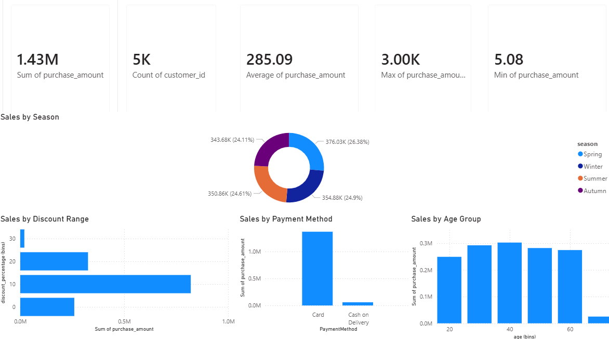

# 🛒 Store Sales & Customer Behaviour Analysis

### SQL | Data Profiling | Data Quality Validation | Data Transformation | Data Modelling | Power BI

---

## 📌 1. Project Overview

This project explores retail purchase records to understand sales performance and customer purchasing patterns using SQL and Power BI.

The analysis follows a structured workflow, starting with raw data profiling and quality validation, followed by data preparation, analytical querying, and dashboard development.

The objective is to transform raw retail data into meaningful business insights by examining purchase value across product categories, customer demographics, seasons, payment methods, and discount ranges.

Rather than focusing only on SQL queries, this project demonstrates how data can be prepared, structured, analysed, and presented to support business understanding and decision-making.

## 🎯 2. Business Objectives

The project aims to answer the following business questions:

- **Overall Performance:** What is the total purchase value, number of purchase records, and average purchase value?
- **Category Performance:** Which product categories contribute the most to total purchase value?
- **Customer Demographics:** How do purchase patterns differ across age groups and genders?
- **Seasonal & Payment Patterns:** How are purchases distributed across seasons and payment methods?
- **Discount & Customer Ratings:** How do purchase values and item ratings vary across discount ranges?

## 📂 3. Dataset Overview & Limitations

The dataset contains **5,000 purchase records** with 11 attributes.

| Attribute | Description |
|---|---|
| CustomerID | Customer identifier |
| Age | Customer age |
| Gender | Customer gender |
| Category | Product category |
| ItemPurchased | Purchased item |
| Amount | Purchase amount |
| Season | Season associated with the purchase |
| PaymentMethod | Payment method used |
| ItemRating | Customer rating for the item |
| DiscountApplied(%) | Applied discount percentage |
| PreviousPurchases | Number of previous purchases |

### Dataset Limitations

The available dataset provides a snapshot of purchase records. However, several business areas cannot be fully evaluated because the required information is not available.

- No transaction date is provided, so time-series, monthly, and year-over-year analysis cannot be performed.
- No product cost or cost-of-goods-sold data is available, so profit margins and profitability cannot be calculated.
- No inventory information is available to assess stock levels or inventory turnover.
- The dataset does not provide sufficient information to establish causal relationships between discounts and purchasing behaviour.
- Each row is treated as an individual purchase record for this analysis. The dataset does not provide a separate transaction identifier to verify multi-item basket relationships.

These limitations define the scope of the analysis and prevent conclusions beyond what the available data supports.

## ⚙️ 4. Data Preparation & Analytical Workflow

The project follows a structured data workflow to prepare the raw dataset for analysis.

### 4.1 Data Profiling

Initial profiling was performed to understand the dataset structure and identify potential data quality issues.

Key checks included:

- Previewing the raw records.
- Reviewing the total number of records.
- Checking distinct customer identifiers.
- Inspecting column values and data consistency.
- Identifying potential missing and inconsistent values.

### 4.2 Data Quality Validation

Data quality checks were performed to inspect the dataset before transformation.

The validation process focused on:

- Checking for NULL values.
- Reviewing duplicate customer identifiers.
- Inspecting text fields for inconsistent formatting.
- Reviewing numerical fields for potential invalid values.
- Identifying unusual or inconsistent discount values.

The checks help establish a clearer understanding of the dataset before proceeding with analytical queries.

### 4.3 Data Transformation

A cleaned staging view named `vw_cleaned_store_sales` was created using SQL.

The transformation process included:

- Standardizing column names using snake_case.
- Applying `TRIM()` to remove unwanted leading and trailing spaces from text fields.
- Creating a standardized analytical view while preserving the original raw dataset.

The raw source table remains unchanged, allowing the cleaned view to serve as the analytical layer.

### 4.4 Data Modelling – Star Schema

A Star Schema structure was designed for the Power BI data model to organize purchase records and supporting descriptive attributes.

The model consists of a central fact table and dimension tables.

**Fact Table**

- `store_sales` – contains the purchase records and numerical values used for analysis.

**Dimension Tables**

- `dim_customers` – contains customer-related attributes such as CustomerID, Age, Gender, and PreviousPurchases.
- `dim_products` – contains product-related attributes such as Category and ItemPurchased.
- `dim_payment` – contains payment and seasonal attributes used to analyse purchase patterns.

The intended relationship structure follows a one-to-many design, with dimension tables filtering the central fact table.

This structure separates descriptive attributes from purchase records and supports analysis across different business dimensions.

### 4.5 SQL Business Analysis

SQL queries were developed to answer the defined business questions.

The analysis covers:

1. Overall purchase metrics.
2. Product category performance.
3. Customer demographics.
4. Seasonal and payment method patterns.
5. Discount ranges and item ratings.
6. Additional analytical exploration.

## 📊 5. Key Business Findings & Analytical Insights

The following findings summarize the results obtained from the SQL analysis.

### 5.1 Overall Purchase Performance

**Business Question**

What is the overall purchase performance represented by the dataset?

**SQL Findings**

- Total Purchase Value: **$1.43M**
- Total Purchase Records: **5,000**
- Average Purchase Value: **$285.09**
- Highest Purchase Value: **$3,000**
- Lowest Purchase Value: **$5.08**

**Business Interpretation**

The dataset records approximately $1.43 million in total purchase value across 5,000 purchase records.

The average purchase value of $285.09 provides a baseline for comparing purchase patterns across categories, customer segments, and other dimensions.

**Potential Business Action**

Use the overall purchase metrics as baseline indicators when comparing category performance and customer purchasing patterns.

### 5.2 Product Category Performance

**Business Question**

Which product categories contribute the most to total purchase value?

**SQL Findings**

- Electronics contributes approximately **$0.90M**, representing around **63%** of total purchase value.
- Electronics is the largest contributor among the categories analysed.

**Business Interpretation**

Electronics accounts for a substantial proportion of the recorded purchase value.

This indicates that the category has a significant contribution to the dataset's overall sales performance. However, purchase value alone does not establish whether the category generates the highest profit.

**Potential Business Action**

Further investigate product-level performance within Electronics to understand which items contribute most to the category's purchase value.

### 5.3 Customer Demographics

**Business Question**

How do purchase patterns differ across customer age groups and genders?

**SQL Findings**

For customers aged 31–40:

| Gender | Purchase Records | Average Purchase Value |
|---|---:|---:|
| Male | 456 | $520.75 |
| Female | 484 | $110.23 |

**Business Interpretation**

Within the 31–40 age group, male purchase records have a higher average purchase value than female purchase records.

However, the number of purchase records is relatively similar between the two groups.

This highlights a difference in average recorded purchase value within this particular segment. It does not establish the reason behind the difference or imply that the same pattern applies to every age group.

**Potential Business Action**

Further examine product category preferences and purchase value distribution within each demographic segment to understand what contributes to the observed differences.

### 5.4 Seasonal & Payment Method Analysis

**Business Question**

How are purchases distributed across seasons and payment methods?

**SQL Findings**

- Purchase records were compared across Spring, Summer, Autumn, and Winter.
- Payment methods were analysed to compare Card and Cash on Delivery (COD).
- Within the Groceries category, COD recorded **173 purchase records**, while Card recorded **159 purchase records**.

**Business Interpretation**

The Groceries category shows a higher number of COD purchase records than Card purchase records in the analysed dataset.

This describes the observed payment distribution but does not establish why customers selected a particular payment method.

Seasonal comparisons also provide a view of how purchase activity is distributed across the four recorded seasons.

**Potential Business Action**

Monitor payment method distribution by product category to identify differences in payment preferences across categories.

### 5.5 Discount & Item Rating Analysis

**Business Question**

How do purchase values and item ratings vary across discount ranges?

**SQL Findings**

- Discount values were grouped into ranges, including Unknown/Invalid, 0%, 1–10%, 11–20%, and 21%+.
- The lower discount ranges account for approximately 2,100 purchase records.
- Average item ratings across the discount ranges are approximately 3.7–3.8.

**Business Interpretation**

The average item ratings across the discount groups are relatively close, with no substantial difference evident from the summarized averages.

This suggests that the recorded ratings are broadly similar across the analysed discount ranges. However, this comparison alone cannot establish whether discounts influence customer satisfaction or purchasing decisions.

**Potential Business Action**

Further investigate purchase value and rating distributions at item level to identify whether specific products or discount ranges show different patterns.

## 💡 6. Business Recommendations & Further Investigation

Based on the findings, several areas could be explored further.

| Area | Suggested Further Investigation |
|---|---|
| Electronics | Examine individual products contributing to the category's high purchase value. |
| Customer Demographics | Compare product preferences and purchase value across age and gender segments. |
| Payment Methods | Investigate payment method distribution across different product categories. |
| Seasonal Patterns | Collect transaction dates to support more detailed seasonal and time-based analysis. |
| Discounts & Ratings | Examine item-level purchase values and rating distributions across discount groups. |

### Additional Data That Could Improve the Analysis

To support deeper business analysis, the following information would be useful:

- Transaction date and time.
- Product cost and selling price.
- Inventory and stock movement.
- Unique transaction or order identifier.
- Promotion and discount campaign details.

These additional fields would enable more detailed analysis of profitability, purchasing trends, basket behaviour, inventory performance, and promotional effectiveness.

## 📊 7. Power BI Dashboard & Visualization

An interactive Power BI dashboard was developed to present the key findings from the SQL analysis. The dashboard uses the Star Schema data model to organize purchase metrics and enable analysis across different business dimensions.

### Executive Summary – Dashboard Overview



### Key Visual Highlights

- **Executive KPI Cards:** Display key purchase metrics, including Total Sales (**$1.43M**), Total Transactions (**5K**), Average Purchase Value (**$285.09**), Highest Purchase (**$3.00K**), and Lowest Purchase (**$5.08**).
- **Sales by Season:** Donut chart showing the distribution of purchase volume and value across Spring, Winter, Summer, and Autumn.
- **Sales by Discount Range:** Clustered bar chart comparing purchase values across different discount percentage ranges.
- **Sales by Payment Method:** Comparative column chart showing the distribution of purchases between Card and Cash on Delivery (COD).
- **Sales by Age Group:** Column chart using **10-year age intervals (`age (bins)`)** to compare purchase patterns across customer age groups.

The dashboard complements the SQL analysis by providing an interactive view of the dataset, allowing users to explore purchase metrics and compare patterns across categories, demographics, seasons, payment methods, and discount ranges.

## 📁 8. Repository Structure

```text
store-sales-analysis/
│
├── csv/
│   └── Raw_store_sales.csv
│
├── reports/
│   └── dashboard_overview.png
│
├── 01_data_profiling.sql
├── 01_data_quality_validation.sql
├── 02_cleaned_staging.sql
│
├── 03_business_analysis_01_overall_metrics.sql
├── 03_business_analysis_02_category_performance.sql
├── 03_business_analysis_03_demographics.sql
├── 03_business_analysis_04_season_payment.sql
├── 03_business_analysis_05_discount_rating.sql
│
├── 04_advanced_analysis.sql
│
├── README.md
└── LICENSE
```

## 🧠 9. Project Reflection

This project provided practical experience in working with raw retail data and developing a structured analytical workflow using SQL and Power BI.

Throughout the project, I worked on data profiling, data quality validation, SQL transformations, analytical queries, data modelling, and dashboard development.

One of the key learning experiences was understanding that data analysis involves more than producing query results or visualizations. It also requires checking data quality, understanding dataset limitations, selecting appropriate analytical approaches, and interpreting findings within the available evidence.

The project strengthened my understanding of how SQL and Power BI can work together to transform raw data into structured analysis and business-focused reporting.

---

**Tools & Technologies:** MySQL | SQL | Microsoft Power BI | Power Query | DAX | Data Modelling | Star Schema